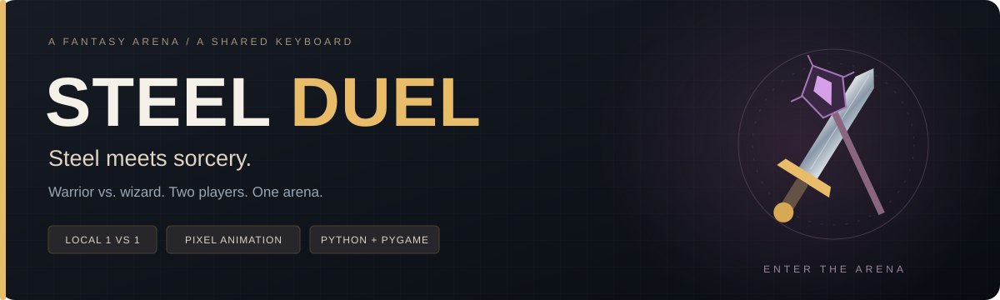
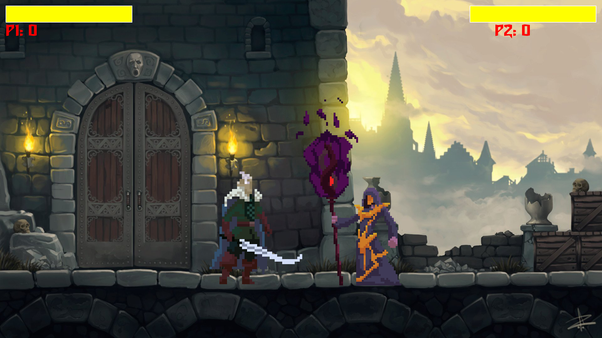
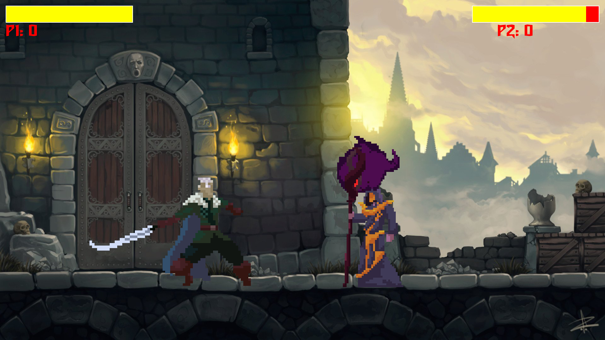
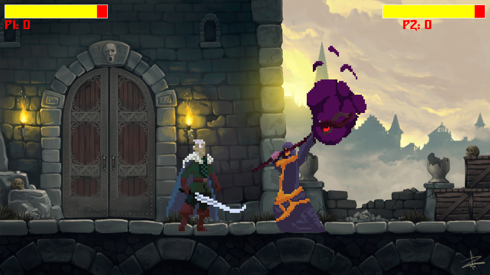

  

  <strong>A local two-player fantasy fighter built with Python and Pygame.</strong> 
  Warrior vs. wizard · Shared keyboard · Animated pixel characters

  <strong>English</strong> · <a href="README.ru.md">Русский</a> 
  <a href="#gameplay">Gameplay</a> · <a href="#quick-start">Play locally</a> ·
  <a href="#controls">Controls</a> · <a href="docs/ROADMAP.md">Roadmap</a> ·
  <a href="https://github.com/nicr0s/steelduelorg/issues">Report an issue</a>

---

**Steel Duel** puts two players in a fantasy arena on the same keyboard. Play as a sword-wielding warrior or a staff-wielding wizard, land attacks, activate temporary damage modifiers, and win rounds by taking your opponent's health to zero.

The project focuses on sprite animation, keyboard input, hit detection, and round management in a compact Pygame codebase.

## Gameplay

  

| Sword attack | Magic attack |
| --- | --- |
|  |  |

Gameplay frames captured from the current Pygame renderer using scripted keyboard input.

## Features

- **Local 1v1 combat** with separate controls for both players.
- **Two fighters** with distinct sprites and attack animations.
- **Seven animation states:** idle, run, jump, two attacks, hit reaction, and death.
- **Health bars and round scores** displayed above the arena.
- **Temporary abilities:** double damage and damage reduction.
- **Automatic round reset** after a victory, with a countdown before combat.
- **Background music and attack sounds** for both fighters.

## Quick start

Use Python 3.10 or newer. The current game was checked with **Python 3.13 and Pygame 2.6.1** on Windows.

~~~bash
git clone https://github.com/nicr0s/steelduelorg.git
cd steelduelorg
python -m venv .venv
~~~

Activate the environment in Windows PowerShell:

~~~powershell
./.venv/Scripts/Activate.ps1
~~~

Or on macOS / Linux:

~~~bash
source .venv/bin/activate
~~~

Install the dependency and launch the game:

~~~bash
python -m pip install -r requirements.txt
python main.py
~~~

Run from the repository root so relative asset paths resolve correctly. The game opens a **1920 × 1080 window** and targets **144 FPS**; actual performance depends on the machine.

## Controls

Both players use the same keyboard. Player 2's attacks and abilities use the **numeric keypad**, rather than the number row.

| Action | Player 1 · Warrior | Player 2 · Wizard |
| --- | --- | --- |
| Move left | `A` | `←` |
| Move right | `D` | `→` |
| Jump | `W` | `↑` |
| Attack 1 | `R` | `Numpad 1` |
| Attack 2 | `T` | `Numpad 2` |
| Double damage | `E` | `Numpad 3` |
| Damage reduction | `Z` | `Numpad 4` |

Close the game window to exit.

### Abilities and rounds

| Ability | Effect | Duration | Activation cooldown |
| --- | --- | --- | --- |
| Double damage | Doubles outgoing hit damage | 5 seconds | 10 seconds |
| Damage reduction | Halves incoming hit damage | 5 seconds | 15 seconds |

Cooldowns are measured from activation. In the current implementation, the first use also waits for the initial cooldown from game startup.

Each fighter starts a round with **100 health**. A base hit deals **10 damage**, adjusted by active abilities. Defeating the opponent adds one point to your score. The victory state lasts about two seconds before the next round is initialized.

## Inside the project

~~~text
steelduelorg/
├── main.py              # Window, audio, UI, game loop, abilities, and scoring
├── fighter.py           # Movement, animation states, hitboxes, and damage
├── requirements.txt     # Pinned Pygame dependency
├── assets/
│   ├── audio/           # Music and attack sounds
│   ├── fonts/           # Game UI font
│   └── images/          # Arena, fighter sprites, and victory graphic
├── docs/
│   ├── images/          # README banner and gameplay captures
│   └── ROADMAP.md       # Planned improvements
├── CONTRIBUTING.md
└── README.ru.md         # Russian documentation
~~~

`main.py` owns the display, countdown, health bars, score, and round lifecycle. The `Fighter` class loads animation frames, reads movement and attack inputs, applies gravity, calculates attack collisions, and manages temporary abilities.

## Current scope

The current release is a local keyboard-play prototype with a fixed window size. A configurable resolution, remappable controls, a pause menu, and visible ability cooldowns are planned in the [roadmap](docs/ROADMAP.md).

On a keyboard without a numeric keypad, Player 2's attack and ability bindings currently need to be changed in `fighter.py` and `main.py`.

Verification covered loading the current assets, running the game loop with scripted inputs, rendering both attack animations, and observing health reduction for both fighters. Full interactive playtesting across operating systems remains future work.

## Contributing

See [CONTRIBUTING.md](CONTRIBUTING.md) for how to report a bug or propose a focused change. Include your Python/Pygame versions and the key sequence that reproduces a gameplay issue.

## Maintainer and asset notes

**Dayrabaev Alikhan** · [@nicr0s](https://github.com/nicr0s)

The bundled Fantasy Warrior and Martial Hero packs include their own CC0 notices: [Fantasy Warrior](assets/images/warrior/License.txt) and [Martial Hero](assets/images/warrior1/License.txt). These notices have been preserved.

A project-wide license file is not currently included. Remaining asset provenance and project licensing are tracked in the roadmap.
